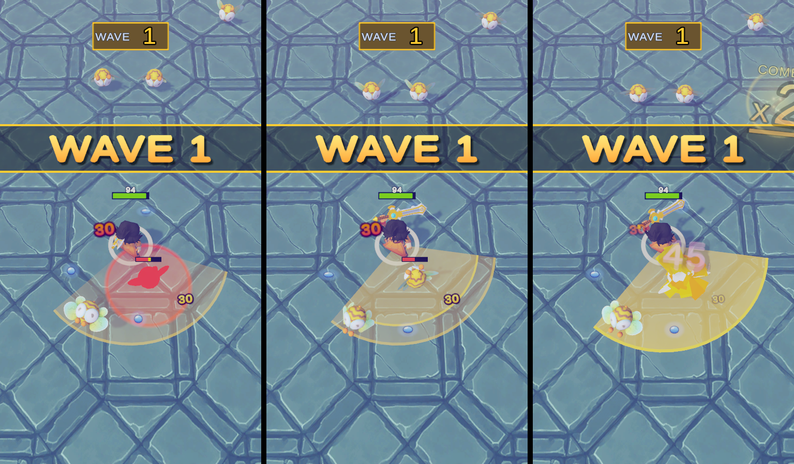

# FEATURE: Attack range charge fill

## 1. Summary
During each swing, a brighter fill grows inside the attack cone from the hero to the arc. It reaches the arc exactly when the damage lands, then flashes with the existing pulse and fades out.

## 2. Why / issue fixed
The player attack needed to be highlighted. The cone showed where the sword hits but not when, so the fill tells the player the exact moment the attack hits.

> Deduced from the human's statement ("I wanted to highlight player attack with a fill so player know when it hits"). Not confirmed word for word.

## 3. Bottleneck
Not given by the human. Deduced from the work: the play-mode capture had to be run twice. The first probe started the game before the services had finished loading, so the hero never attacked. The feature code itself worked on the first compile.

> To be confirmed by the human.

## 4. Time spent

| Phase | Time |
|---|---|
| Analysis | `29 s` (17:45:08 → 17:45:37) |
| Implementation + tuning / testing | `5 min 50 s` (17:45:37 → 17:51:27, not split: no timestamp was taken between them) |
| Asset generation / integration | none |
| **Total** | `6 min 19 s` |

Real elapsed time from timestamps taken during the session. The analysis time looks short and was not confirmed by the human.

## 5. Files changed
- `AttackRangeView.cs`: a second fan layer (the fill) under the cone, grown during the windup and faded with the pulse. `BuildCone` takes a center alpha so the fill is even instead of fading toward the hero.
- `AttackRangeConfig.cs`: three tuning values for the fill (`chargeAlpha`, `chargeEdgeAlpha`, `chargeCurve`), next to the other attack range values. Set in `SwordAttackRange.asset`.

## 6. Technical flow
1. At startup the view builds two meshes from the weapon: the faint cone (as before) and the fill. The fill is a child of the cone, so it turns, hides and pops with it.
2. `HeroController.OnAttackStarted` starts the charge. The fill's size goes from 0 to 1 over the weapon's `HitDelay`, through the charge curve. Scaling the fan from the hero grows its radius without changing its angle.
3. `HeroController.OnAttacked` (the damage lands) ends the charge. The fill is at full size and touches the arc. The existing pulse plays and the fill fades with it.
4. If a new swing starts during a pulse, the charge takes over the fill.
5. A game state change, or the cone hiding (hero dead, start screen), stops both animations and hides the fill.
6. The view only updates while a charge or a pulse is running.

## 7. Tuning values
- `attackRangeChargeAlpha` = `0.22`: strength of the fill (0 = no fill area).
- `attackRangeChargeEdgeAlpha` = `0.75`: strength of the bright front at the edge of the growing fill.
- `attackRangeChargeCurve` = ease-in: how the fill grows over the windup. Ease-in makes it rush into the hit.
- The duration is not a tuning value: it is the weapon's `HitDelay`, so the fill always matches the real hit timing.

## 8. Addressables
- **Used?** No new asset. The fill reuses the cone's `VFX/AttackRange` material, already preloaded by `FeedbackAssetsService`.
- **Why no new asset:** the fill is the same shape and tint as the cone. A property block changes its strength per renderer without touching the shared Addressable material.

## 9. Generated assets
- **Used?** No.

## 10. Edge cases and limits
- `HitDelay` of 0: the fill appears full at once.
- If the slash never lands (the game ends during the windup), the fill is hidden by the game state change.
- The fill stays at full size if the slash comes late, it never overshoots the arc.
- No new allocations per swing: the meshes are rebuilt only when the weapon changes.
- With the default ease-in, the first frames of the fill are very small. This is deliberate, but can be changed with the curve.

## 11. Base project observations
- Calling `GameFlowService.StartGame()` before `ServicesLocator` has finished initializing makes `HeroController` throw a null reference: its update loop starts before `EnemiesController` is initialized. The real start screen cannot do this, only a test script can.

## 12. Likely review questions
- **Why does the fill use `HitDelay` and not its own duration?** It must touch the arc exactly when the damage lands. Reading the weapon value keeps it right when a designer changes the weapon.
- **Why a second mesh and not a shader?** The cone is already a mesh built in code. A second fan scaled from the hero is the simplest way to grow the radius, with no new shader or asset.
- **Why is the fill a child of the cone?** It turns, hides and pops with the cone for free.
- **Why a property block?** The material is shared and Addressable. Changing it would change the cone too.
- **What if two swings overlap?** A new charge takes over the fill. The pulse keeps playing on the cone.

## 13. 30-second explanation
The cone showed where the attack hits, but not when. A brighter fill now grows inside it during the windup and reaches the arc on the exact frame the damage lands, then flashes and fades with the pulse. It is a second fan mesh in the same view, timed by the weapon's `HitDelay` and listening to the hero's existing attack events. No new asset, three tuning values.

## 14. README entry

### Attack range charge fill — 6 min
- **Implemented:** to highlight the attack, a fill now grows inside the attack cone during the swing and reaches its edge exactly when the hit lands, so the player knows when it hits. Details in [the feature note](Documentation/FeatureNotes/26_AttackRangeChargeFill.md).
- **Time:** 6 min
- **Bottleneck:** not confirmed.
